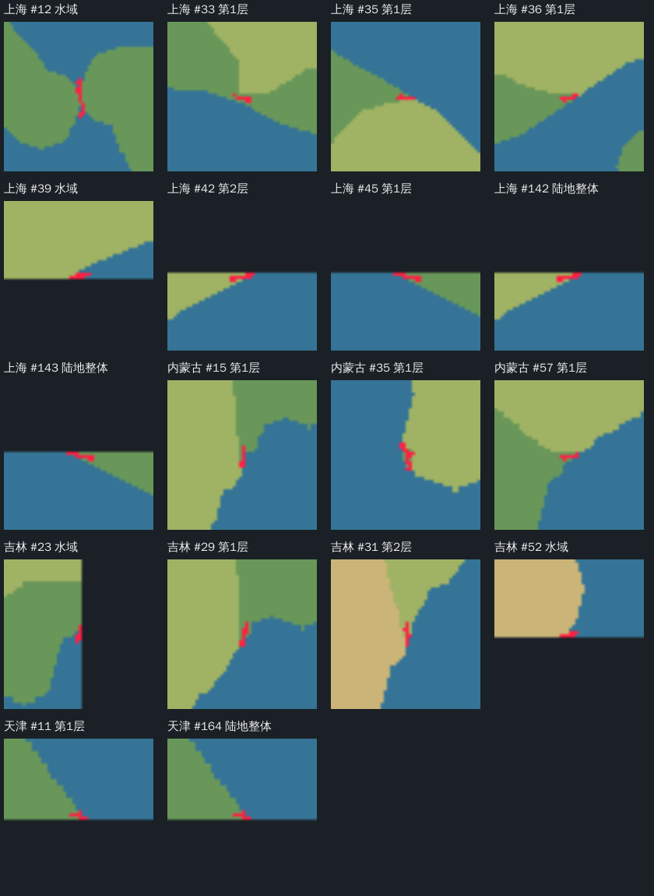
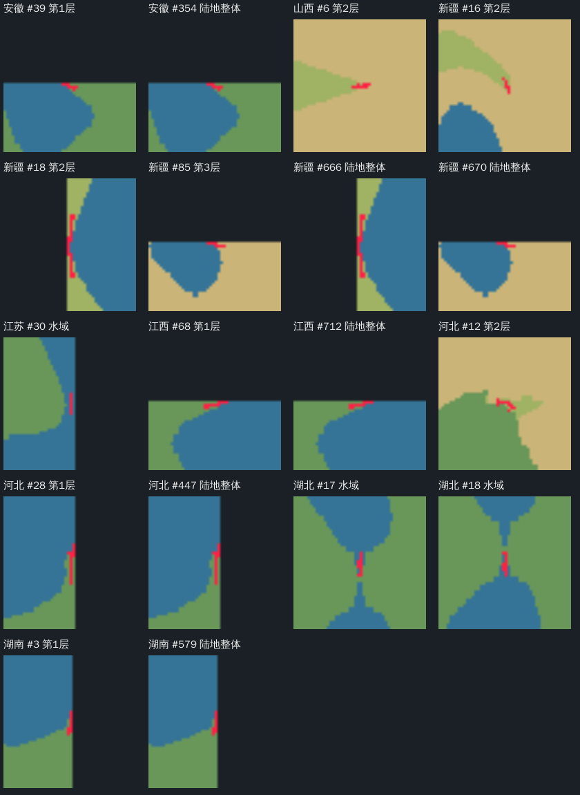
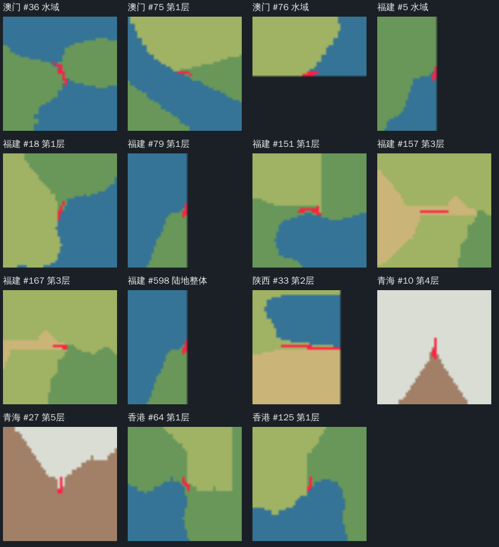

# 全地区游戏预览重新验收（2026-10-30）

本文为修订前的只读验收快照。11 个失败地区现已完成局部修订，当前结论及前后证据见[24 处预览修复报告](preview-intrusion-repair-2026-10-30.md)。下文保留当时结果，逐区 `acceptance-2026-10-30.json` 对应修改前版本。

34 个地区、135 张现有图片、21,760,000 个预览地形像素已重新回读。网格、图片校验和、分层与水陆／高度数组一致性、小水域全周归属均通过。

按最新规则，11 个地区确认有 24 处不足 5 格的细长部分／窄颈，记失败；其余 23 个地区记待核验，不能宣称全部符合新标准。交战路线未在当前设计预览中定稿并绑定，因此 34 地区均不能证明 10 格实际通路通过；赠送建筑没有预览落点，本次不适用，不代表现有可玩地图的赠送排除通过。

所有原始预览、分层、水陆掩码、参数及已冻结可玩制作源保持原字节。本轮只验收并留证，没有将失败项自动归并或拓宽，也没有安装、重建或改写可玩地图。

## 判定方法与边界

先逐格回读分层、设计高度和水域，校验 135 张 PNG 的结构、尺寸及当前报告校验和，并比较每张 preview.png 的全部 800×800 地形像素；独立重算闭合小水域的调整前接岸票数与当前归属。

宽度工具按水平、垂直和两条对角方向扫描格方块的实际交线长度，保存不足 5 格的断面端点、中心与方向，按相邻中心分组。空间延伸至少 5 格只用于筛查优先级，不是新增公共规则。所有 51 条延伸候选均对照局部放大图复核；其中 24 条确认属于细长尾部、窄连接或水域窄颈，其余涉及框边裁切，待用途及范围复核。层级与陆地整体检测可能在同一位置重叠，51 是候选记录数。

短断面仍全部留在逐区候选文件中，需区别自然圆角与细尖尾；四向采样不能证明任意方向完整最小净宽，零延伸候选不等同完整通过。未提供已定交战路线时不自选“交战线”凑验收；没有原生导航和实体占地时不把颜色宽度当作实际通行净宽。

按规则，确认不足部分需要在后续明确修订任务中就近归并；属于交战路线的段须按 10 格补足并保留连接。涉及原小水域岸带时，归并方案还须保持其归属与全周过渡，不能凭最近颜色盲目改层。

## 逐区结果

| 地区 | 原有预览项目 | 确认不足5格 | 延伸候选记录 | 最新综合结论 | 同版证据 |
|---|---|---:|---:|---|---|
| 上海 | 通过 | 4 | 9 | 失败 | [报告](../../maps/上海/data/terrain-preview/acceptance-2026-10-30.json) · [标记图](../../maps/上海/data/terrain-preview/width-diagnostics-2026-10-30.png) |
| 云南 | 通过 | 0 | 0 | 待核验 | [报告](../../maps/云南/data/terrain-preview/acceptance-2026-10-30.json) · [标记图](../../maps/云南/data/terrain-preview/width-diagnostics-2026-10-30.png) |
| 内蒙古 | 通过 | 3 | 3 | 失败 | [报告](../../maps/内蒙古/data/terrain-preview/acceptance-2026-10-30.json) · [标记图](../../maps/内蒙古/data/terrain-preview/width-diagnostics-2026-10-30.png) |
| 北京 | 通过 | 0 | 0 | 待核验 | [报告](../../maps/北京/data/terrain-preview/acceptance-2026-10-30.json) · [标记图](../../maps/北京/data/terrain-preview/width-diagnostics-2026-10-30.png) |
| 台湾 | 通过 | 0 | 0 | 待核验 | [报告](../../maps/台湾/data/terrain-preview/acceptance-2026-10-30.json) · [标记图](../../maps/台湾/data/terrain-preview/width-diagnostics-2026-10-30.png) |
| 吉林 | 通过 | 2 | 4 | 失败 | [报告](../../maps/吉林/data/terrain-preview/acceptance-2026-10-30.json) · [标记图](../../maps/吉林/data/terrain-preview/width-diagnostics-2026-10-30.png) |
| 四川 | 通过 | 0 | 0 | 待核验 | [报告](../../maps/四川/data/terrain-preview/acceptance-2026-10-30.json) · [标记图](../../maps/四川/data/terrain-preview/width-diagnostics-2026-10-30.png) |
| 天津 | 通过 | 0 | 2 | 待核验 | [报告](../../maps/天津/data/terrain-preview/acceptance-2026-10-30.json) · [标记图](../../maps/天津/data/terrain-preview/width-diagnostics-2026-10-30.png) |
| 宁夏 | 通过 | 0 | 0 | 待核验 | [报告](../../maps/宁夏/data/terrain-preview/acceptance-2026-10-30.json) · [标记图](../../maps/宁夏/data/terrain-preview/width-diagnostics-2026-10-30.png) |
| 安徽 | 通过 | 0 | 2 | 待核验 | [报告](../../maps/安徽/data/terrain-preview/acceptance-2026-10-30.json) · [标记图](../../maps/安徽/data/terrain-preview/width-diagnostics-2026-10-30.png) |
| 山东 | 通过 | 0 | 0 | 待核验 | [报告](../../maps/山东/data/terrain-preview/acceptance-2026-10-30.json) · [标记图](../../maps/山东/data/terrain-preview/width-diagnostics-2026-10-30.png) |
| 山西 | 通过 | 1 | 1 | 失败 | [报告](../../maps/山西/data/terrain-preview/acceptance-2026-10-30.json) · [标记图](../../maps/山西/data/terrain-preview/width-diagnostics-2026-10-30.png) |
| 广东 | 通过 | 0 | 0 | 待核验 | [报告](../../maps/广东/data/terrain-preview/acceptance-2026-10-30.json) · [标记图](../../maps/广东/data/terrain-preview/width-diagnostics-2026-10-30.png) |
| 广西 | 通过 | 0 | 0 | 待核验 | [报告](../../maps/广西/data/terrain-preview/acceptance-2026-10-30.json) · [标记图](../../maps/广西/data/terrain-preview/width-diagnostics-2026-10-30.png) |
| 新疆 | 通过 | 1 | 5 | 失败 | [报告](../../maps/新疆/data/terrain-preview/acceptance-2026-10-30.json) · [标记图](../../maps/新疆/data/terrain-preview/width-diagnostics-2026-10-30.png) |
| 江苏 | 通过 | 0 | 1 | 待核验 | [报告](../../maps/江苏/data/terrain-preview/acceptance-2026-10-30.json) · [标记图](../../maps/江苏/data/terrain-preview/width-diagnostics-2026-10-30.png) |
| 江西 | 通过 | 0 | 2 | 待核验 | [报告](../../maps/江西/data/terrain-preview/acceptance-2026-10-30.json) · [标记图](../../maps/江西/data/terrain-preview/width-diagnostics-2026-10-30.png) |
| 河北 | 通过 | 1 | 3 | 失败 | [报告](../../maps/河北/data/terrain-preview/acceptance-2026-10-30.json) · [标记图](../../maps/河北/data/terrain-preview/width-diagnostics-2026-10-30.png) |
| 河南 | 通过 | 0 | 0 | 待核验 | [报告](../../maps/河南/data/terrain-preview/acceptance-2026-10-30.json) · [标记图](../../maps/河南/data/terrain-preview/width-diagnostics-2026-10-30.png) |
| 浙江 | 通过 | 0 | 0 | 待核验 | [报告](../../maps/浙江/data/terrain-preview/acceptance-2026-10-30.json) · [标记图](../../maps/浙江/data/terrain-preview/width-diagnostics-2026-10-30.png) |
| 海南 | 通过 | 0 | 0 | 待核验 | [报告](../../maps/海南/data/terrain-preview/acceptance-2026-10-30.json) · [标记图](../../maps/海南/data/terrain-preview/width-diagnostics-2026-10-30.png) |
| 湖北 | 通过 | 2 | 2 | 失败 | [报告](../../maps/湖北/data/terrain-preview/acceptance-2026-10-30.json) · [标记图](../../maps/湖北/data/terrain-preview/width-diagnostics-2026-10-30.png) |
| 湖南 | 通过 | 0 | 2 | 待核验 | [报告](../../maps/湖南/data/terrain-preview/acceptance-2026-10-30.json) · [标记图](../../maps/湖南/data/terrain-preview/width-diagnostics-2026-10-30.png) |
| 澳门 | 通过 | 2 | 3 | 失败 | [报告](../../maps/澳门/data/terrain-preview/acceptance-2026-10-30.json) · [标记图](../../maps/澳门/data/terrain-preview/width-diagnostics-2026-10-30.png) |
| 甘肃 | 通过 | 0 | 0 | 待核验 | [报告](../../maps/甘肃/data/terrain-preview/acceptance-2026-10-30.json) · [标记图](../../maps/甘肃/data/terrain-preview/width-diagnostics-2026-10-30.png) |
| 福建 | 通过 | 4 | 7 | 失败 | [报告](../../maps/福建/data/terrain-preview/acceptance-2026-10-30.json) · [标记图](../../maps/福建/data/terrain-preview/width-diagnostics-2026-10-30.png) |
| 西藏 | 通过 | 0 | 0 | 待核验 | [报告](../../maps/西藏/data/terrain-preview/acceptance-2026-10-30.json) · [标记图](../../maps/西藏/data/terrain-preview/width-diagnostics-2026-10-30.png) |
| 贵州 | 通过 | 0 | 0 | 待核验 | [报告](../../maps/贵州/data/terrain-preview/acceptance-2026-10-30.json) · [标记图](../../maps/贵州/data/terrain-preview/width-diagnostics-2026-10-30.png) |
| 辽宁 | 通过 | 0 | 0 | 待核验 | [报告](../../maps/辽宁/data/terrain-preview/acceptance-2026-10-30.json) · [标记图](../../maps/辽宁/data/terrain-preview/width-diagnostics-2026-10-30.png) |
| 重庆 | 通过 | 0 | 0 | 待核验 | [报告](../../maps/重庆/data/terrain-preview/acceptance-2026-10-30.json) · [标记图](../../maps/重庆/data/terrain-preview/width-diagnostics-2026-10-30.png) |
| 陕西 | 通过 | 0 | 1 | 待核验 | [报告](../../maps/陕西/data/terrain-preview/acceptance-2026-10-30.json) · [标记图](../../maps/陕西/data/terrain-preview/width-diagnostics-2026-10-30.png) |
| 青海 | 通过 | 2 | 2 | 失败 | [报告](../../maps/青海/data/terrain-preview/acceptance-2026-10-30.json) · [标记图](../../maps/青海/data/terrain-preview/width-diagnostics-2026-10-30.png) |
| 香港 | 通过 | 2 | 2 | 失败 | [报告](../../maps/香港/data/terrain-preview/acceptance-2026-10-30.json) · [标记图](../../maps/香港/data/terrain-preview/width-diagnostics-2026-10-30.png) |
| 黑龙江 | 通过 | 0 | 0 | 待核验 | [报告](../../maps/黑龙江/data/terrain-preview/acceptance-2026-10-30.json) · [标记图](../../maps/黑龙江/data/terrain-preview/width-diagnostics-2026-10-30.png) |

## 延伸候选局部图

红色为不足 5 格的采样断面中心，深色为可玩框外，不把框外部分当作通行空间。三张图覆盖本轮全部 51 条延伸候选，具体断面、人工判定和坐标见逐区文件；全图标记中的橙色为短断面候选。







## 复现与保护

```sh
cargo test --release --locked --example preview-acceptance
cargo run --release --locked --example preview-acceptance -- . work/preview-acceptance-2026-10-30/widths
```

宽度工具的五项测试覆盖不足／恰好门槛的走廊、10 格需求、斜向细条及圆形封端；批量执行不改输入。独立 NPZ/PNG 回读脚本在本轮 work 目录，输入 SHA-256 快照另保存为 [受保护输入清单](preview-acceptance-2026-10-30/input-hashes.json)，逐区报告记录当前候选身份、Frame、图片身份及规则身份。

[机器汇总](preview-acceptance-2026-10-30.verification.json) · [现行验收规范](../spec/map_acceptance.md#交战路线宽度与伸入地形如何验)
