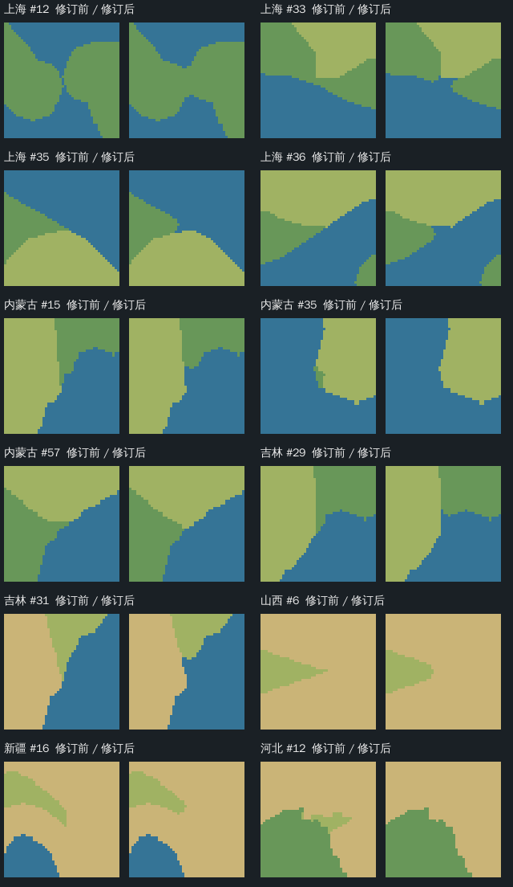
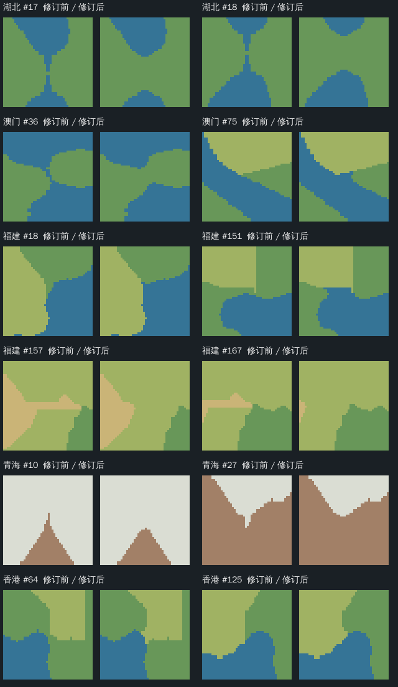

# 游戏预览细长地形修订（2026-10-30）

已修订上一轮确认不合格的 **11 个地区、24 处细长地形，重绘 44 张图片**。合计修改 699 格设计分层，其中 350 格改变水陆类别；原始高程、地理取景、800×800 可玩网格和四周 20 格边框保持。

不足 5 格的尖尾、贴岸细条和水缝已就近归并；河北与福建切除窄连接后遗留的局部碎层一并归入相邻层。对照图已逐处人工核对，修改范围内复扫没有延伸不足 5 格的候选。保留小水域的全周同层归属及接入未改动归属层主体已独立复核。

| 地区 | 修复问题 | 修改格数 | 水陆变化格数 | 当前预览与验收 |
|---|---:|---:|---:|---|
| 上海 | 4 | 94 | 94 | [预览](../../maps/上海/preview.png) · [边界](../../maps/上海/preview--line.png) · [验收](../../maps/上海/data/terrain-preview/acceptance-repair-2026-10-30.json) |
| 内蒙古 | 3 | 64 | 26 | [预览](../../maps/内蒙古/preview.png) · [边界](../../maps/内蒙古/preview--line.png) · [验收](../../maps/内蒙古/data/terrain-preview/acceptance-repair-2026-10-30.json) |
| 吉林 | 2 | 52 | 52 | [预览](../../maps/吉林/preview.png) · [边界](../../maps/吉林/preview--line.png) · [验收](../../maps/吉林/data/terrain-preview/acceptance-repair-2026-10-30.json) |
| 山西 | 1 | 26 | 0 | [预览](../../maps/山西/preview.png) · [边界](../../maps/山西/preview--line.png) · [验收](../../maps/山西/data/terrain-preview/acceptance-repair-2026-10-30.json) |
| 新疆 | 1 | 27 | 0 | [预览](../../maps/新疆/preview.png) · [边界](../../maps/新疆/preview--line.png) · [验收](../../maps/新疆/data/terrain-preview/acceptance-repair-2026-10-30.json) |
| 河北 | 1 | 74 | 0 | [预览](../../maps/河北/preview.png) · [边界](../../maps/河北/preview--line.png) · [验收](../../maps/河北/data/terrain-preview/acceptance-repair-2026-10-30.json) |
| 湖北 | 2 | 49 | 49 | [预览](../../maps/湖北/preview.png) · [边界](../../maps/湖北/preview--line.png) · [验收](../../maps/湖北/data/terrain-preview/acceptance-repair-2026-10-30.json) |
| 澳门 | 2 | 47 | 47 | [预览](../../maps/澳门/preview.png) · [边界](../../maps/澳门/preview--line.png) · [验收](../../maps/澳门/data/terrain-preview/acceptance-repair-2026-10-30.json) |
| 福建 | 4 | 190 | 79 | [预览](../../maps/福建/preview.png) · [边界](../../maps/福建/preview--line.png) · [验收](../../maps/福建/data/terrain-preview/acceptance-repair-2026-10-30.json) |
| 青海 | 2 | 34 | 0 | [预览](../../maps/青海/preview.png) · [边界](../../maps/青海/preview--line.png) · [验收](../../maps/青海/data/terrain-preview/acceptance-repair-2026-10-30.json) |
| 香港 | 2 | 42 | 3 | [预览](../../maps/香港/preview.png) · [边界](../../maps/香港/preview--line.png) · [验收](../../maps/香港/data/terrain-preview/acceptance-repair-2026-10-30.json) |

## 修改前后对照

每项左侧为修订前、右侧为修订后，编号对应上轮候选 ID。来源高程没有改动，`source.png` 的水域着色与当前设计水域同步。





## 验收范围与保留项

44 张 PNG 的结构、校验和、尺寸通过；逐格核对 7,040,000 个预览像素与设计数组，水陆、高度、完整网格及保护范围均通过。3570 个既有受保护文件 SHA256 一致，包含其余 23 地区、原始参考、可玩配方、完整冻结制作源、布局及历史。没有更改或安装可玩地图。

对全部 34 地区再次复扫，剩余 27 条延伸候选均包含触及游戏框边界的断面；其中修订的 11 地区有 17 条，继续保留待验；短封端／圆角断面也留在当前宽度报告中。四向采样和视觉复核不证明任意方向全图最小净宽。34 地区的交战通路尚未绑定本版设计，10 格实际净宽仍待路线定稿与原生导航验收；赠送建筑本轮不适用。不能将本次修复记为所有新要求完整通过。

[上轮只读报告](preview-acceptance-2026-10-30.md)保留为修订前结论；上述 11 地区的当前结果以 `acceptance-repair-2026-10-30.json` 为准。[机器汇总](preview-intrusion-repair-2026-10-30.verification.json)绑定本轮输入、图片和逐处证据。

## 重现与复核

各图 `raw/before-intrusion-repair-2026-10-30/` 保存原数组、参数、报告和旧岸线验收；`intrusion-reference.npz` 为当前设计参考。局部开运算半径为本轮明确采用的 3 格，碎层清理限定在原问题周边，继承本图已有碎层面积门槛；这不是新增公共宽度规则。所有归并目标均有实际共享边，逐格变化、原断面与修订后断面在 `intrusion-repair-2026-10-30.json` 留档。

```sh
cargo run --release --locked --example preview-intrusion-repair -- <隔离项目根> docs/evidence/preview-repair-2026-10-30/reviewed-sites.json
cargo run --release --locked --example preview-acceptance -- . <宽度输出目录>
cargo run --release --locked --example verify-preview-intrusion-repair -- . <独立回读报告.json>
```

普通重绘继续用 `terrain-preview <地区> maps/<地区>/data/terrain-preview/input.npz`，当前参数显式采用已审阅设计参考的分层和水域；重绘先校验参考与来源高程、边界及网格一致。修订工具使用修订前快照，不能用当前图反复累积平滑。

写回后的 11 地区已再次独立回读通过；地形预览模块 11 项测试、局部修订工具 3 项测试、独立回读工具 3 项测试，以及 Rust 格式与差异检查通过。独立回读工具自带 ZIP／NPY／PNG／CRC 解析，不复用管线写入端的数组与图像解码。
