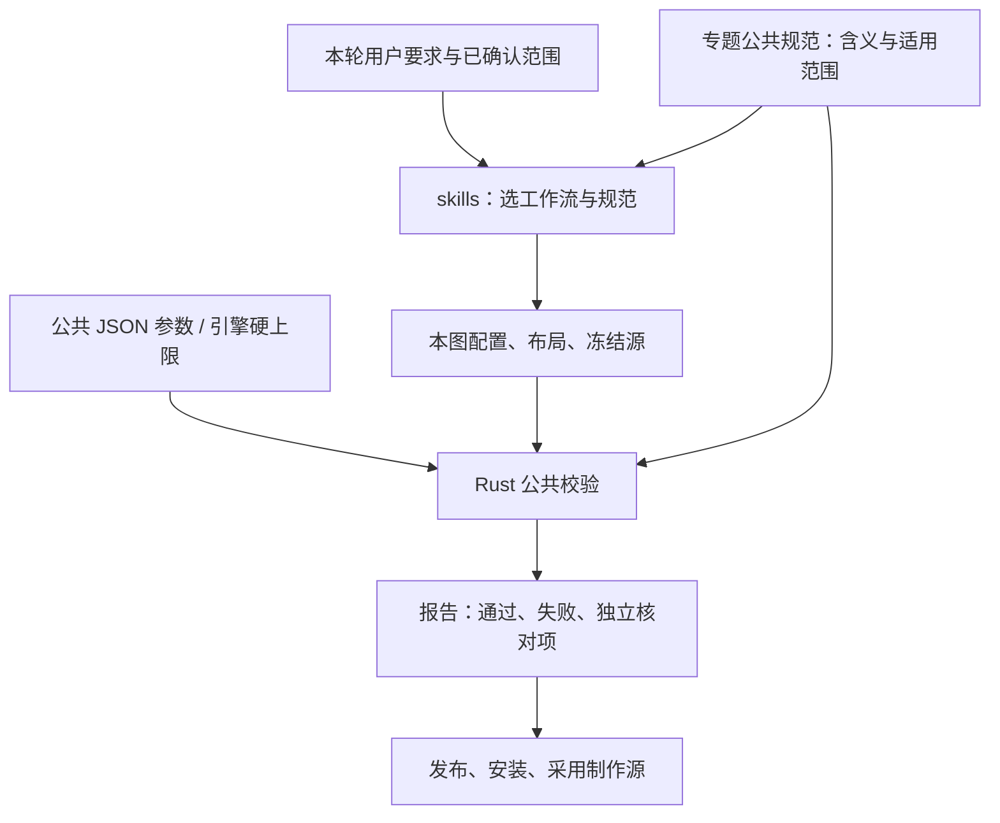

# 公共约束总表

本文件统一公共规范、技能与流水的关系、适用范围和规则归属。具体规则在下表指向的专题规范维护；skills 负责选择输入和执行步骤，代码负责计算与拒绝不合格成品，验收报告提供本次执行证据。历史研究仅作资料，不提供旧规则执行或发布入口。

全部交付必检项统一列在[公共交付验收](map_acceptance.md#交付必检项)，该文件维护证据、状态、联动复查与交付结论；本文维护规则归属和自动覆盖，两者分别查阅。

## 每层负责什么

| 层 | 唯一职责与修改位置 |
|---|---|
| 本轮要求 | 决定交付范围、已确认落点和允许的修改；明确选择可以覆盖设计默认，不能使引擎不支持的地图变为可发布 |
| 专题公共规范 `docs/` | 解释规则含义、取值口径、适用阶段和当前严格验收边界；本文是这些规范的总入口 |
| 公共参数 `templates/rules/` | 保存可执行默认参数；距离与预留不能在 skills 中另设一份默认值 |
| 本图输入 `maps/<id>/` | 配置引用与允许的局部覆盖、实际布局、Frame、原生来源、版本和例外证据；不把本图坐标提升为公共参数 |
| 项目 skills | 识别任务、选来源、路由专题规范与工具；不复制阈值表、对置方位列表或版本史 |
| Rust 流水 `src/` | 读取生效参数、计算约束、保护事务、验证完整成品；程序通过只代表报告中实际覆盖的检查 |
| 报告与历史 | 保留输入身份、参数、生效策略及结果；旧报告、旧地图示例不覆盖现行规范 |

出生点、矿位分级和坡口的可配置默认参数统一来自 [coordinate-pipeline.json](../templates/rules/coordinate-pipeline.json)。`src/rules.rs` 从该文件内嵌读取隔离工程的后备默认值，避免 Rust `Default` 再维护一份数字。实际运行仍读取工程自己的参数文件及对应允许的地图覆盖；固定几何模型由专题指定的模块维护，不误列为可覆盖参数。

引擎硬上限由对应模块的唯一常量维护，例如 `resources::terrain_package::MAX_TEXTURES`；它不是可由地图放宽的距离参数。预览尺寸、格式结构及材质选材分别由下表指定的实现维护，不强行塞入空间参数文件。

## 规则、参数与执行对应

| 规则 ID | 含义的权威说明 | 参数／真实输入 | 执行与覆盖状态 |
|---|---|---|---|
| `INPUT.SOURCE` | [坐标流水](coordinate_pipeline.md)、[Rust 配方](rust_migration.md) | 新图的 `LAYERS`/`LAYOUT`；冻结成品的 `COORDINATE_PIPELINE` | 自动：源 ZIP、CRC、布局身份与原生内容；来源选择仍由本轮范围决定 |
| `DATA.OFFICIAL` | [官方资源流水](official_resource_pipeline.md) | 固定 revision、输入 SHA-256、限定 Include/继承来源及已验证预加载成员 | 自动使用内嵌索引；未解析定义和局部覆盖明确 pending，不用目录存在性推断预加载或完整运行能力 |
| `XML.STRUCTURE` | [官方资源流水](official_resource_pipeline.md) | EA GameMap/Atlas 结构子集与最终 XML | 所有生产入口严格验收当前分组、结构及实际覆盖；诊断仅供只读检查，不授权发布；不宣称完整 XSD 或游戏运行验证 |
| `FRAME.AXIS` | [地图坐标](map_coordinates.md) | 本图 `coordinates::Frame`，预览设计帧独立 | 自动换算与回读；PNG 图例和留白不是地形格数 |
| `PREVIEW.GRID` | [公共预览](terrain_preview.md) | 预览配置、地理范围、DEM、水域掩码；尺寸由公共预览实现维护 | 自动固定正方形网格、同取景分层；资料真实性和岸线设计另行核对 |
| `TERRAIN.TRANSITIONS` | [地形交接规范](terrain_transitions.md)、[交接验收](map_acceptance.md#地形交接如何验) | 本图实际高度、水面、层界、坡口、导航及主材质／混合；AXAI／NKL／SMAI 样本只作衔接研究 | **独立必检，尚无完整公共自动门禁**：从预览预留、可玩几何到材质整理联合处理斜坡、层界、岸线及交汇处；分别核对几何、材质、导航与视觉证据，复用现有专业记录，不据局部工具通过推定整体连续 |
| `LAYOUT.ATTACK_ROUTES` | [分级布矿](resource_distribution.md)、[对位方向与沿线验收](map_acceptance.md#对位进攻方向与沿线布置如何验) | 对位两座实际基地的连线、玩家／固定 AI、主攻与侧翼路线及真实地形；不固定配对、地图坐标、角度阈值或坡数 | **独立必检，尚无完整公共自动门禁**：以对位基地连线为大致进攻方向，优先安排直接主攻路线和沿线跨层坡口，再分散布矿；主路不得出现不必要的绕远，不能为保留矿位改走远坡，也不能用侧翼路线或仅可达代替直接主路 |
| `TERRAIN.ROUTE_WIDTH` | [交战路线与伸入地形整理](terrain_preview.md#交战路线与伸入地形整理)、[宽度验收](map_acceptance.md#交战路线宽度与伸入地形如何验) | `#/terrain_shape/combat_route_minimum_width_cells`、交战路线及原生高度／导航／占地 | **独立必检，尚无完整自动门禁**：交战通行路线上的层、陆地、水域净宽至少 10 格；新增／变更线路须叠加全部潜在赠送主备／条件分支地基、出口及接驳预留后逐段测量，不足就地拓宽或在任务范围内联动整理并保持连续接入；无赠送通路通过不能替代 |
| `TERRAIN.INTRUSIONS` | [交战路线与伸入地形整理](terrain_preview.md#交战路线与伸入地形整理)、[归并验收](map_acceptance.md#交战路线宽度与伸入地形如何验) | `#/terrain_shape/intrusion_minimum_width_cells`、实际伸入区域及邻接关系 | **独立必检，尚无完整自动门禁**：细长伸入的层、陆地、水域净宽至少 5 格，不足部分就近归并；交战段同时满足 10 格 |
| `SPAWN.GROUP` | [出生点规则](spawn_placement.md) | `#/spawn_placement`、允许的地图覆盖及实际出生航点／两矿 | 自动：对置侧别、近矿数、完整预留、同层或同水域连通；开局两矿可为直接进攻通路与坡口小幅挪位，仍须满足全部出生组约束；所有可玩来源和增量编辑均严格零问题，来源中的已有问题不能继承 |
| `SPAWN.SEAT_ORDER` | [角落与中间位置](spawn_placement.md#p5p8-的角落与中间位置) | 所选对置方向、实际可用地形及 P5–P8 原生出生航点 | **独立必检，尚无公共自动门禁**：P5、P6 位于该队一侧的两个角落，P7、P8 位于两者之间的中间区域 |
| `SPAWN.TEAM_AREA` | [水陆面积均衡](spawn_placement.md#两队水陆面积均衡) | 原生水陆、可玩范围几何中线、选定方位与本轮例外记录 | **人工独立验收**：现有公共出生点校验尚未接入面积门禁；须留面积与差异率记录，不能以 `spawn_placement.passed` 代替 |
| `ORE.STAGES` | [分级布矿](resource_distribution.md)、[沿线验收](map_acceptance.md#对位进攻方向与沿线布置如何验) | `#/resource_distribution`、`RESOURCE_DISTRIBUTION` 计划、实际矿对象 | 自动结果按报告实际覆盖的配额、唯一阶段、家区和主次线位置记录；所有可玩图按八人48矿模板仅留16座开局矿，第3–6阶段32矿全部退出所有基地100格家区，沿拟定主次线分散；方向与散布合理性仍为独立必检，不能据分级自动通过推断完整布局通过 |
| `ORE.HOTSPOT_DISTANCE` | [热点路程验收](map_acceptance.md#热点路程如何验) | 每座第 5 矿、主线配对、同域实际路径及生效通行策略 | **独立必检**：可复用公共静态路线结果，比较双方到同一目标的路程并留布置结论；无公共差异率自动上限，跨域运输不推断距离 |
| `NEUTRAL.COMBAT_AREA` | [中立建筑选址](resource_distribution.md#中立建筑的交战区选址)、[选址验收](map_acceptance.md#中立建筑选址如何验) | 拟定中间交战区、实际出生点、全部适用中立建筑原生落点与接入路径；无公共固定距离或间距阈值 | **独立必检，尚无公共自动门禁**：车库、医院、机场、精兵学院等中立建筑分散在中间交战区附近，远离各出生点 |
| `RAMP.RESERVE` | [坡口避让](ramp_clearance.md)、[山地坡形](mountain_ramps.md) | `#/ramp_clearance`、允许的本图覆盖、模块固定资源预留模型、真实坡宽／端口／标高 | 自动：完整坡口与轴向端口区、矿盘／矿场／中立建筑避让、坡面和静态通路 |
| `RAMP.PRIORITY` | [斜坡优先级与冲突处理](ramp_clearance.md#斜坡优先级与冲突处理)、[独立验收](map_acceptance.md#斜坡优先级如何验) | 全部合理坡道的坡体、坡宽、端口和完整上下引道；各阶段矿的完整占地；设计基准与原生前后差异 | **独立必检，尚无完整公共自动门禁**：斜坡优先于矿，冲突移矿；不得为保矿削坡、缩坡、移坡或缩减预留。最终几何零冲突不能证明设计优先级已落实 |
| `RAMP.ROUTE_PLACEMENT` | [山地坡道](mountain_ramps.md)、[对位方向与沿线验收](map_acceptance.md#对位进攻方向与沿线布置如何验) | 对位基地连线方向、直接主攻通路、沿线实际低高层交界、坡位及两端标高／接入；不设朝向对手的轴向角度阈值 | **独立必检，尚无完整公共自动门禁**：沿路线跨层处选坡；坡面轴向按该处实际低高层交界和端口连接确定 |
| `RAMP.ACCESS` | [斜坡数量与通行布局](mountain_ramps.md#斜坡数量与通行布局)、[通行便利验收](map_acceptance.md#交战区与资源通行便利如何验) | 本图出生点、主／次交战区入口、全部资源目标、原生路径与坡口；不设坡数上限或固定配额 | **独立必检，尚无完整自动门禁**：方便玩家通往交战区及矿、油井、医院等中立资源，检查实际路径、绕行与瓶颈，按需增设／移动坡口；不能以静态可达代替便利性 |
| `SHORE.PERIMETER` | [岸线设计](terrain_preview.md#游戏水域整理)、[整圈验收](map_acceptance.md#整圈岸线如何验) | 本图设计水域、全周过渡高度及原生导航 | **独立必检，公共自动覆盖不完整**：逐段记录全部适用边界与双向结果；预览连片、少数坡口可达不算通过 |
| `SHORE.SINGLE_LAYER` | [小水域单层包裹](terrain_preview.md#小水域的单层包裹)、[岸线验收](map_acceptance.md#整圈岸线如何验) | 本图小水域适用清单、调整前各层接岸长度、归属层及局部修改范围、前后分层 | **独立必检，尚无公共自动门禁**：跨层小水域归入接触最多的层，全周岸边只接触该层并与主体连通；预览核对实际分层，可玩图另验全周过渡与双向通行 |
| `TEXTURE.PACKAGE` | [公共纹理规范](terrain_texture_rules.md#公共纹理清理与数量上限)、[地形封装](terrain_package_fix.md) | `MAX_TEXTURES`、实际主贴图／双混合／悬崖 UV 引用；`materials.rs` 管选材 | 自动：整理入口清除全部未使用项、同步四处材质声明；运行时最多 49 种，发布／安装／采用源均检查；完整原生来源仍须满足同一资源完整性和数量门禁 |
| `GAMEPLAY.GIFTS` | [公共赠送规则](production_placement_fix.md) | `common-T0.5.1.json#/production_placement`、本图 `RULESET` 与原生脚本 | 自动：完整水陆占地、主备避让、占用重试、朝向与脚本引用；不推断运行时 AI 行为 |
| `GAMEPLAY.PLACEMENT_PRIORITY` | [布局优先级与统一选址](production_placement_fix.md#布局优先级与统一选址) | 显式矿／中立布局、全部赠送主备、所属基地、静态域内接入和可移动装饰 | 赠送入口统一全部主点先于备用，生产优先、同级按地形受限程度与占地排序；产能用基地接入排序，匿名装饰必要退让。全图资源联合规划与选址设计仍独立核对 |
| `GAMEPLAY.GIFT_PROXIMITY` | [赠送生产建筑靠近所属基地](production_placement_fix.md#赠送生产建筑靠近所属基地)、[靠近基地验收](map_acceptance.md#赠送生产建筑靠近基地如何验) | 实际脚本归属／座位、所属基地锚点、全部主备／分支落点、Frame 与实际接入；无公共固定距离上限 | **选址优先原则、独立必检，尚无完整自动门禁**：在已有硬约束内优先就近；原航点搜索范围与几何／朝向报告不证明距所属基地合理 |
| `GAMEPLAY.OFFICIAL_GEOMETRY` | [官方资源流水](official_resource_pipeline.md) | 官方独立地基、多碰撞体、显式出口及最终朝向，叠加原公共预留 | 所有生产入口对适用对象严格验收；未解析锚点／缩放／覆盖为 pending 并阻止相关生产放行；矿场官方事实与政策预留分开记录 |
| `NAV.UNIT_STATES` | [官方资源流水](official_resource_pipeline.md) | 原生水域及代表单位的官方 LocomotorSet/Surfaces | **追加静态诊断**：分别分析普通/出厂等条件，不推断状态切换、完整引擎寻路或 AI；不替代现有资源路线门禁及通行便利验收 |
| `GAMEPLAY.GIFT_TERRAIN` | [赠送建筑避开伸入地形](production_placement_fix.md#赠送建筑避开伸入地形)、[独立验收](map_acceptance.md#交战路线宽度与伸入地形如何验) | `#/terrain_shape/exclude_gift_buildings_from_intrusions`、完整伸入区域及全部赠送主备／条件分支 | **独立必检，尚无完整自动门禁**：所有赠送建筑完整占地、出入口与接驳均避开伸入层、陆地、水域，宽度达标仍禁放；现有赠送模块通过不代表本项通过 |
| `BUILDING.ANGLES` | [所有建筑四向规范及矿脉范围](production_placement_fix.md#所有建筑的四向约束)、[朝向验收](map_acceptance.md#建筑朝向如何验) | 全部建筑、`OreNode` 原生 angle 与相关创建／转向动作；赠送规则的 `allowed_angles_degrees` 与四向规范一致 | **建筑和矿脉共同必检**：`production_facing` 自动检查指定赠送动作，`ore_facing` 回读全部矿脉及可识别的显式创建／命名转向动作；普通／冻结回读与发布、安装、采用源均拒绝非法矿角度。隐式或动态矿角度待核验并拒绝，未解析的间接脚本目标及其他建筑须独立回读；漏查矿脉不能通过，旋转后复验占地和通路 |
| `EDIT.NATIVE_SCOPE` | [坐标流水](coordinate_pipeline.md)、[本轮保护与交付](map_acceptance.md#执行记录与交付) | 完整原生来源、对象身份／属性／归属、脚本树与触发条件、本轮授权修改清单及前后差异 | **增量保护、独立核对**：保留原生身份和既有玩法触发；矿、坡、赠送及中立建筑仅在任务范围内作必要联动，逐项记录落点／朝向／关联检查区变化，不扩写无关归属、外交或触发逻辑 |
| `RELEASE.FROZEN` | [流水与版本](blueprint_versions.md)、[可复现构建](reproducible_builds.md) | 本版配置、完整源包、布局、基准、所选蓝图 | 自动：完整封装、回滚、原字节镜像、发布与安装前门禁；先核对本轮变化，再采用新源 |
| `RELEASE.INDEPENDENT` | [结构化独立验收](map_acceptance.md#结构化独立验收门禁) | 同版候选文件、原生／Frame／布局、生效参数与计划、各项审核及证据文件 | 自动核对独立记录的身份、完整性与状态；缺证据不提交发布，保留待审候选。程序不代替专业设计判断 |

所有 `#/...` 均指 `templates/rules/coordinate-pipeline.json`，赠送规则行明确指定另一文件。新规范未覆盖的实现不得在 skills 中写成“已自动验收”。 `terrain_shape` 当前统一规划与独立验收的净宽及赠送排除政策，尚未作为自动地形整形或赠送选址门禁执行；不能把参数已登记描述为程序已自动落实。

## 统一规则、参数覆盖与完整来源

1. **所有可玩地图**：执行现行规范及各项生效策略。共同规划按[对位路线与沿路布矿](resource_distribution.md#对位进攻路线与沿路布矿)推进；全部坡道执行 `RAMP.PRIORITY`，出生组、分级、赠送和通路约束同时满足，不以一种检查替代另一种。
2. **允许覆盖的参数**：公共参数与专题规范定义覆盖入口；`SPAWN_PLACEMENT`、`RAMP_CLEARANCE` 仅覆盖允许的参数，所有来源均执行严格检查。出生平台和矿盘取本图与公共预留的有效下限，不能用较小的局部值取消完整占地。
3. **明确的用户选择**：只影响本轮已授权的设计要求，在本图计划中记录原规则、选择、影响及仍未满足的项。自然语言授权不会自动改变程序参数或令失败报告变为通过；引擎上限与资源完整性仍须满足。
4. **完整原生来源**：用于读取实际几何、保护身份与本轮无关内容，不豁免当前规则。原样重建、重新封装、冻结来源及版本对照均要求两矿家区、完整分级计划和严格零问题；无计划、旧三矿或来源已有问题不能放行。只有通过当前完整验收的候选才能发布、安装或采用来源。
5. **规划要求与硬门禁分开**：报告要分别列出自动检查和独立人工结果。总的 `passed`、空间零问题或来源基准，均不能替代尚未覆盖的水陆面积、全周岸线及热点路程核对。

## 冲突处理与维护

- 坡矿冲突统一由[斜坡优先级与冲突处理](ramp_clearance.md#斜坡优先级与冲突处理)维护；路线选取、坡形、出生组各保留自己的专业约束。工具阶段顺序和局部对象保护锁不改变设计优先级，详见[流水入口](coordinate_pipeline.md)。
- 每项约束只在表中指定的专题维护含义；可执行参数只改公共 JSON 或模块硬常量；skills 通过链接引用，不复制数字表。
- 新增或修改公共规则时，同时维护受影响 skills 的执行顺序／规范路由，以及[交付验收](map_acceptance.md)中对应项的适用范围、证据和判定；按[技能分工与交接](map_skills_checklist.md)核对覆盖，不在 skills 重复保存验收细则。
- 修改公共参数时，同步解释、实现和行为回归。默认值变更不能只改一个调用处，验收也须读取同一生效策略。参数与内容身份继续参与现有证明／缓存绑定。
- 更新规则关系或入口时维护本表和 [技能索引](map_skills_checklist.md)。保留的研究资料须注明不可作为旧规则执行入口，删除成品的下载和修复链接。
- 方位统一以现行[出生点规则](spawn_placement.md)为准，使用 `west_east`、`south_north`、`southwest_northeast`；不保留历史参考放行或旧方位算法。角落与中间位置另行独立验收。
- 预览统一按现行正方形标准；原生矩形格式解析能力不构成新图设计标准的例外。

某张地图的专用审计通过不代表公共自动门禁已完整覆盖；上表标明的独立必检项按公共验收留证。后续自动化进入相应公共模块，不再复制地图专用脚本。
